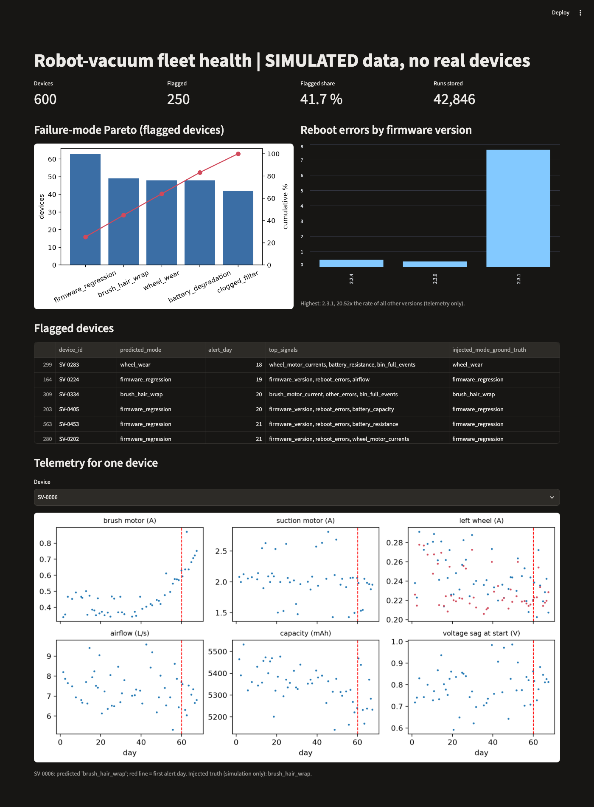

# connected-fleet-rca

A host-simulated connected-appliance pipeline: **600 simulated robot vacuums publish run telemetry over MQTT, an ingest service lands it in SQLite, and ML finds which units are failing, which failure mode it is, and which signals say so.**

> **Everything here is synthetic.** There is no real field data, no real customers, no real devices, and no data from any company. No microcontroller or board was used: the "devices" are Python objects, the broker is a pure-Python MQTT broker running on a Mac. Physical constants (currents, voltages, airflow) are plausible round numbers chosen by me, not measurements of any product. Fault effects are my own modelling assumptions. Read the metrics as "does this method work on a simulator I wrote and can inspect", not as performance on real robots.

## Architecture

```
simulate.py            publisher.py              broker.py            ingest.py            SQLite
 600 virtual  ──JSON──▶ paho clients ──QoS 1──▶ amqtt broker ──QoS 1──▶ paho subscriber ──▶ data/fleet.db
 vacuums, seeded       fleet/<id>/telemetry     (pure Python)          schema.py validates   runs / rejected
 + injected faults                                                     INSERT OR IGNORE
                                                                              │
              features.py (per-device baseline, 7/14-day windows, causal)  ◀──┘
                     │
   detectors.py: rule baseline | IsolationForest (unsupervised) | HistGradientBoosting (modes)
                     │
   evaluate.py (split by device, metrics, lead time)  explain.py (occlusion, Pareto, firmware grouping)
                     │
   results/*.json ──▶ scripts/make_readme_tables.py ──▶ this README      dashboard.py (Streamlit)
```

Per run each device reports: battery voltage (start, minimum, sag at spin-up, in V), measured pack capacity (mAh), mean current of the suction motor, brush-roll motor and both wheel motors (A), airflow (L/s), runtime (min), area cleaned (m^2), bin-full events, error codes and firmware version. Failure modes injected on a minority of devices, each with a known onset day and (for the four degrading modes) a known hard-failure day:

| Mode | What changes | Hard failure |
|---|---|---|
| `brush_hair_wrap` | brush current rises, stall warnings, then jam | brush jam error |
| `clogged_filter` | airflow falls, suction current falls, bin-full false triggers | low-suction error |
| `battery_degradation` | capacity fades, pack resistance and voltage sag grow | low-battery error |
| `wheel_wear` | one wheel's current rises (left/right asymmetry) | wheel stall error |
| `firmware_regression` | reboot errors only on firmware 2.3.1, only on susceptible units | none (no hard failure) |

Healthy devices are deliberately not boring: per-unit motor and battery spread, carpet vs hard floor, pet homes with hair that builds and is cleared, filters that clog and are washed, slow battery ageing, a third of homes change their floor mix mid-life, and 40 healthy units get the same 2.3.1 OTA but are not susceptible. Details are in `src/fleet/simulate.py`.

## Run it

All commands below were run by me from this directory (Python 3.12, [uv](https://docs.astral.sh/uv/)):

```bash
uv sync                                   # install pinned deps from uv.lock
uv run pytest -q                          # 12 tests, includes broker + publisher + ingest integration
bash scripts/run_pipeline.sh              # whole pipeline, ~10-15 min; rewrites results/*.json and the tables below
uv run python -m fleet.run_transport      # step 1 only: simulate -> MQTT -> data/fleet.db
uv run python -m fleet.run_analytics      # step 2 only: features, detectors, RCA, checks
uv run streamlit run src/fleet/dashboard.py   # dashboard (needs the pipeline outputs)
```

The broker is `amqtt` (pure Python) so no system install is needed; Homebrew mosquitto was not used.

## Method notes (read before trusting any number)

* **Split by device.** 60 % of devices train, 40 % test, stratified by injected mode; a device never has rows on both sides (asserted in code and in `results/leakage_checks.json`). Plain row-level splits would leak, because one device's neighbouring days are near-copies.
* **Per-device baseline.** Each signal is divided by that device's own mean over its first 10 days, so a heavy-carpet home is not mistaken for a fault. Faults start on day 14 or later, so the baseline is clean. A real fleet would need a way to know a unit's baseline is clean; that is an assumption.
* **Causal features.** Day-d features use only runs up to day d (tested).
* **Labels.** A faulty device's rows are labelled with its mode from the onset day onward, even though the first days after onset show almost no effect. That makes early rows inherently ambiguous and costs some measured recall.
* **Alerting.** A device alerts after 3 consecutive flagged days. Every detector's threshold is set on training devices only so that at most 5 % of healthy training devices ever alert (gradient boosting: using out-of-fold scores), then frozen. On the test set this budget is met only approximately, see the false-alarm columns.
* **Explanation check is lenient.** "A physically expected signal is in the top 3 of 10 signal groups" is an easy bar; it shows the explanations are not nonsense, not that they are precise.
* **Transport reliability.** Publisher PUBACKs do not prove the subscriber got the message. Unrepaired first-pass loss is measured, then devices resend missing run numbers (gap-fill). The 20 deliberately corrupted payloads are also repaired by gap-fill, so the final store holds every generated message.
* **Device verdict.** The predicted mode of an alerted device is taken over all its rows from the first alert day to the end of its data, so it benefits from hindsight. The "correct mode on first alert day" figure is the stricter early-warning number.
* **Hard-failure error codes are not features.** The simulator emits them on the failure day; a real rule would catch those at lead time zero, which says nothing about early warning.
* **Baselines.** The rule baseline uses fixed per-signal limits set at a healthy-population percentile (no per-device baseline, no ML). Isolation Forest never sees a label while fitting; only its alert threshold is calibrated with labels, and it cannot name a mode.
* **Lead time** = injected hard-failure day minus first-alert day, counted only for degrading-mode devices alerted before the failure day.
* **Root cause** is an occlusion explanation (replace one signal by the healthy median, measure the drop in the predicted-mode probability) plus group permutation importance. It shows what the model used; it does not prove physical causation.

## Results

All tables are generated from `results/*.json` by `scripts/make_readme_tables.py`; do not edit by hand.

<!-- RESULTS:START -->
### Ingest (`results/ingest_report.json`)

| Quantity | Value |
|---|---|
| Devices x simulated days | 600 x 90 |
| Messages published (QoS 1), PUBACKs received | 42846, 42846 |
| Deliberately corrupted payloads injected / rejected by validator | 20 / 20 ({'bad_value': 10, 'missing': 5, 'topic_device_mismatch': 5}) |
| Valid messages / stored after first pass / lost in transit (first pass) | 42826 / 42826 / 0 (loss rate 0.0) |
| Gap-fill rounds (republished, stored after) | 20, 42846 |
| Rows missing after gap-fill (of all generated) | 0 |
| First-pass end-to-end throughput | 4983.3 msgs/s (8.598 s) |

Negative control with amqtt's stock 5 s QoS 1 ack timeout and no gap-fill (`results/ingest_report_default_timeout.json`): 42826 valid sent, 41999 stored, 827 lost (loss rate 0.019311), 6232.1 msgs/s.

### Failure-mode metrics on 240 held-out devices (`results/metrics.json`)

Train: 360 devices, test: 240 devices (test composition: {'healthy': 140, 'firmware_regression': 24, 'brush_hair_wrap': 19, 'clogged_filter': 19, 'battery_degradation': 19, 'wheel_wear': 19}). No device appears in both.

| Mode | n test devices | Rule P | Rule R | Rule F1 | GB P | GB R | GB F1 |
|---|---|---|---|---|---|---|---|
| healthy | 140 | 0.86 | 0.94 | 0.90 | 0.96 | 0.96 | 0.96 |
| brush_hair_wrap | 19 | 0.94 | 0.79 | 0.86 | 0.95 | 0.95 | 0.95 |
| clogged_filter | 19 | 0.90 | 0.47 | 0.62 | 0.83 | 0.79 | 0.81 |
| battery_degradation | 19 | 0.73 | 1.00 | 0.84 | 1.00 | 1.00 | 1.00 |
| wheel_wear | 19 | 1.00 | 0.74 | 0.85 | 0.95 | 1.00 | 0.97 |
| firmware_regression | 24 | 0.95 | 0.79 | 0.86 | 0.96 | 1.00 | 0.98 |

Macro-F1 over the 5 fault modes: rule baseline 0.807, gradient boosting 0.942. GB names the right mode on the first alert day for 100.0 % of alerted faulty devices (95).

### Detection and lead time on the same test devices

| Detector | Fault recall (any mode) | Precision | Healthy devices alerted | Alerted before hard failure (of 76 degrading) | Lead median (days) | Lead p90 (days) |
|---|---|---|---|---|---|---|
| Rule baseline | 0.78 | 0.91 | 8/140 | 58 | 9.0 | 21.0 |
| Isolation Forest (unsupervised) | 0.48 | 0.86 | 8/140 | 45 | 11.0 | 17.0 |
| Gradient boosting | 0.95 | 0.94 | 6/140 | 69 | 15.0 | 23.0 |

Lead time = days between the first alert and the injected hard-failure day, over degrading-mode devices alerted before it. Firmware regressions have no hard-failure day.

Per-mode lead time for gradient boosting:

| Mode | Devices | Alerted before failure | Median (d) | p90 (d) |
|---|---|---|---|---|
| brush_hair_wrap | 19 | 18 | 13.5 | 17.0 |
| clogged_filter | 19 | 13 | 8.0 | 12.6 |
| battery_degradation | 19 | 19 | 19.0 | 24.2 |
| wheel_wear | 19 | 19 | 16.0 | 24.0 |

Gradient-boosting confusion matrix (rows = true, columns = predicted):

| true \ pred | healthy | brush_hair_wrap | clogged_filter | battery_degradation | wheel_wear | firmware_regression |
|---|---|---|---|---|---|---|
| healthy | 134 | 1 | 3 | 0 | 1 | 1 |
| brush_hair_wrap | 1 | 18 | 0 | 0 | 0 | 0 |
| clogged_filter | 4 | 0 | 15 | 0 | 0 | 0 |
| battery_degradation | 0 | 0 | 0 | 19 | 0 | 0 |
| wheel_wear | 0 | 0 | 0 | 0 | 19 | 0 |
| firmware_regression | 0 | 0 | 0 | 0 | 0 | 24 |

### 5-fold device-level cross-validation (`results/cv_summary.json`)

| Detector | Macro-F1 (fault modes) | Fault recall | Healthy false-alarm rate | Median lead (d) |
|---|---|---|---|---|
| Rule baseline | 0.822 +/- 0.044 | 0.782 +/- 0.057 | 0.057 +/- 0.061 | 7.700 +/- 2.088 |
| Isolation Forest | n/a | 0.468 +/- 0.032 | 0.037 +/- 0.022 | 10.400 +/- 1.020 |
| Gradient boosting | 0.952 +/- 0.022 | 0.952 +/- 0.027 | 0.029 +/- 0.030 | 14.800 +/- 0.748 |

### Root cause (`results/pareto.json`, `results/rca_test_devices.json`, `results/firmware_grouping.json`)

Fleet Pareto, out-of-fold predictions over all devices:

| Predicted mode | Devices | Share | Cumulative |
|---|---|---|---|
| firmware_regression | 63 | 0.25 | 0.25 |
| brush_hair_wrap | 49 | 0.20 | 0.45 |
| wheel_wear | 48 | 0.19 | 0.64 |
| battery_degradation | 48 | 0.19 | 0.83 |
| clogged_filter | 42 | 0.17 | 1.00 |

Injected truth for comparison: {'firmware_regression': 60, 'brush_hair_wrap': 48, 'clogged_filter': 48, 'battery_degradation': 48, 'wheel_wear': 48}.

Reboot errors by firmware version (grouping, telemetry only):

| Firmware | Devices | Runs | Reboots / 100 runs | 95% CI |
|---|---|---|---|---|
| 2.2.4 | 344 | 9989 | 0.45 | 0.337-0.602 |
| 2.3.0 | 530 | 27323 | 0.344 | 0.281-0.421 |
| 2.3.1 | 100 | 5534 | 7.644 | 6.973-8.373 |

2.3.1 shows 20.52x the reboot rate of the other versions.

Explanation check: for correctly-moded flagged test devices, a physically expected signal is among the top 3 in 95/95 cases (100.0 %). Top signal groups by permutation importance: firmware_version, battery_resistance, wheel_motor_currents, brush_motor_current.

### Leakage and easiness checks (`results/leakage_checks.json`)

| Check | GB macro-F1 (fault modes) / count | Fault recall | Healthy false-alarm rate |
|---|---|---|---|
| Device overlap train/test | 0 |  |  |
| Ground-truth columns used as features | 0 |  |  |
| shuffled_training_labels | 0.000 | 0.03 | 0.01 |
| no_firmware_features | 0.959 | 0.97 | 0.04 |
| no_error_or_firmware_features | 0.783 | 0.74 | 0.03 |
| no_slope_features | 0.918 | 0.91 | 0.04 |

By injected fault strength (GB, test devices):

| Strength | Devices | Alerted | Correct mode |
|---|---|---|---|
| mild(0.3-0.6) | 26 | 0.92 | 0.92 |
| medium(0.6-0.9) | 42 | 0.93 | 0.93 |
| strong(0.9-1.2) | 32 | 1.00 | 1.00 |
<!-- RESULTS:END -->

## Dashboard



Screenshot of the Streamlit dashboard, rendered headlessly (Chrome driven over the DevTools protocol) on the simulated data. Verdicts shown are out-of-fold.

## Layout

`src/fleet/` simulator, MQTT broker/publisher/ingest, features, detectors, evaluation, explanations, dashboard · `tests/` · `scripts/` · `results/` committed outputs · `docs/STUDY.md` guided walkthrough and interview questions.
